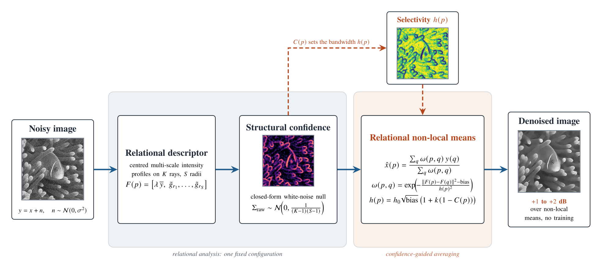
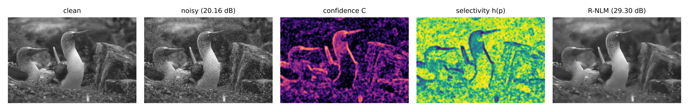

# CRISP — relational non-local means

**Training-free image denoising by cross-scale self-similarity of directional
intensity-difference profiles.**



CRISP performs a non-local weighted average of intensities, like non-local means
(NLM), but it measures the similarity between two pixels in **relation space**
rather than by comparing raw patches. Each pixel gets a **multi-scale directional
relation profile**: the centred, arc-averaged pattern of intensity differences
sampled along `K` rays at `S` geometric radii, plus one lightly smoothed
intensity value. This descriptor is a better matching key than a patch because it
is already partly denoised (multi-scale and arc-averaged), contrast
normalizable, and it sees oriented structure at several radii that a small patch
misses.

A **structural confidence field** `C(p) in [0, 1]` — a noise-weighted blend of the
relational scale-stability statistic `Sigma` (which has a closed-form white-noise
null distribution) and a noise-floor-subtracted local contrast term — sets the
per-pixel selectivity: smooth hard where `C` reads noise, hold back where it
reads structure.

The method is training-free, uses one fixed configuration for every image and
noise level, and runs at the computational cost of NLM.

## How it works

1. **Relation profiles.** For each pixel `p`, sample the image along `K`
   directions at `S` radii, averaging a few tangential taps per sample. Subtract
   the ring mean (centring removes the common-mode noise term). Stack the
   profiles with one smoothed intensity value to form the feature `F(p)`.
2. **Structural confidence.** The cross-scale stability of the normalized profile,
   `Sigma`, is `N(0, 1 / ((K - 1)(S - 1)))` under pure noise, so a spatially
   aggregated `Sigma` is a calibrated structure detector. Fuse it with a
   noise-floor-subtracted contrast term to get `C(p)`.
3. **Relational NLM.** Average the noisy intensities over a search window with
   weights `w(p, q) = exp(-(||F(p) - F(q)||^2 - bias) / h(p)^2)`, where each
   feature column is pre-scaled to unit noise variance (so `bias` is known and
   subtracted) and the bandwidth `h(p) = h0 * sqrt(bias) * (1 + k (1 - C(p)))`
   widens on flat regions and tightens on structure.



*Left to right: clean image, noisy input, confidence field `C`, per-pixel
selectivity `h(p)`, and the restored image. `C` is high on contours and texture
and low on the flat background; `h(p)` is its inverse.*

## Results

Additive white Gaussian noise, one frozen configuration. PSNR (dB) / SSIM.
R-NLM is compared with NLM (both training-free); BM3D is listed for reference.

| Set | sigma | NLM | **R-NLM** | BM3D | R-NLM − NLM |
|-----|------:|-----|-----------|------|-------------|
| BSD68 (68)   | 15 | 28.73 / .784 | **30.22 / .850** | 31.13 / .880 | **+1.49 / +.066** |
| BSD68 (68)   | 25 | 26.47 / .702 | **27.94 / .775** | 28.61 / .809 | **+1.47 / +.073** |
| BSD68 (68)   | 50 | 23.89 / .579 | **24.91 / .629** | 25.68 / .689 | **+1.02 / +.050** |
| Set12 (12)   | 25 | 27.44 / .774 | **28.86 / .816** | 29.98 / .854 | **+1.42 / +.042** |
| Kodak24 (24) | 25 | 27.45 / .715 | **29.09 / .777** | 29.96 / .815 | **+1.64 / +.062** |
| CBSD68 color (20) | 25 | 26.73 / .709 | **28.94 / .827** | 31.13 / .884 | **+2.21 / +.119** |

R-NLM recovers roughly two thirds of the NLM-to-BM3D gap and stays about
0.7 to 0.9 dB below BM3D in grayscale. Both novel components (the confidence
modulation and the intensity-anchored relational feature) are load-bearing, each
worth about 1 dB. Full numbers, ablations, and timing are in the method article.

## Install

```bash
pip install -e .                 # numpy, scipy, scikit-image
pip install -e ".[fast]"         # + numba (compiled inner loop, recommended)
```

Python 3.10 or newer.

## Use

```python
import numpy as np
from crisp import denoise, analyze, CrispConfig

out = denoise(noisy)                 # relational NLM, default mode="rnlm"
                                     # grayscale (H, W) or color (H, W, 3), float 0..255
C   = analyze(noisy)["C"]            # just the structural confidence field

# tuning (defaults are the frozen configuration used for every result above)
denoise(noisy, CrispConfig(rnlm_radius=7, rnlm_intensity_w=2.2,
                           rnlm_h=0.6, rnlm_hmod_k=0.8))
```

### Quick demo

```bash
python demo.py                                   # cameraman, sigma = 25
python demo.py samples/color/kodim23_parrots.png # a color sample
python demo.py samples/grayscale/house.png 40    # custom noise level
```

Adds Gaussian noise to a sample image, denoises it, prints PSNR / SSIM, and
writes a `noisy | denoised | clean` strip. See [`samples/`](samples/).

## Repository layout

```
crisp/            the package
  relational.py     relational non-local means (the denoiser)
  pipeline.py       analyze() -> confidence field C ; denoise() -> restored image
  profiles.py       multi-scale directional relation profiles
  primitives.py     Sigma (scale stability), Phi (phase coherence)
  contrast.py       noise-floor-subtracted contrast, confidence fusion
  config.py         CrispConfig: every knob, with the frozen defaults
  metrics.py        PSNR, SSIM, EPI, AUC
  harmonics.py, shrink.py, reconstruct.py, sampling.py, phantom.py
demo.py           end-to-end example on a sample image
tests/            pytest smoke tests
samples/          a few standard test images (see samples/README.md)
```

## Limitations

- About 0.7 to 0.9 dB below BM3D in grayscale (2 to 3 dB below BM3D-rgb in color):
  no transform-domain Wiener stage.
- A mild low-frequency blotch can appear in dark near-flat regions, an
  NLM-family artefact.
- The reference implementation is NumPy plus a Numba inner loop, not a fully
  compiled build.
- Validated on synthetic Gaussian noise. Real sensor noise and a learned
  reference are out of scope here.

Here is the updated citation section with the published article details and DOI:

## Citation

This code accompanies the MethodsX article:

Rafi, M. A. H., Johora, M. F., Hossain, M. D., Islam, M. M., Nipun, M. M. K., & Sultana, T. (2026). *Relational non-local means for image denoising by cross-scale self-similarity of directional intensity-difference profiles*. **MethodsX, 17**, 104230. https://doi.org/10.1016/j.mex.2026.104230

Please cite this article when using the code in your research.

## License

MIT, see [`LICENSE`](LICENSE). Sample images keep the terms of their original
sources ([`samples/README.md`](samples/README.md)).
